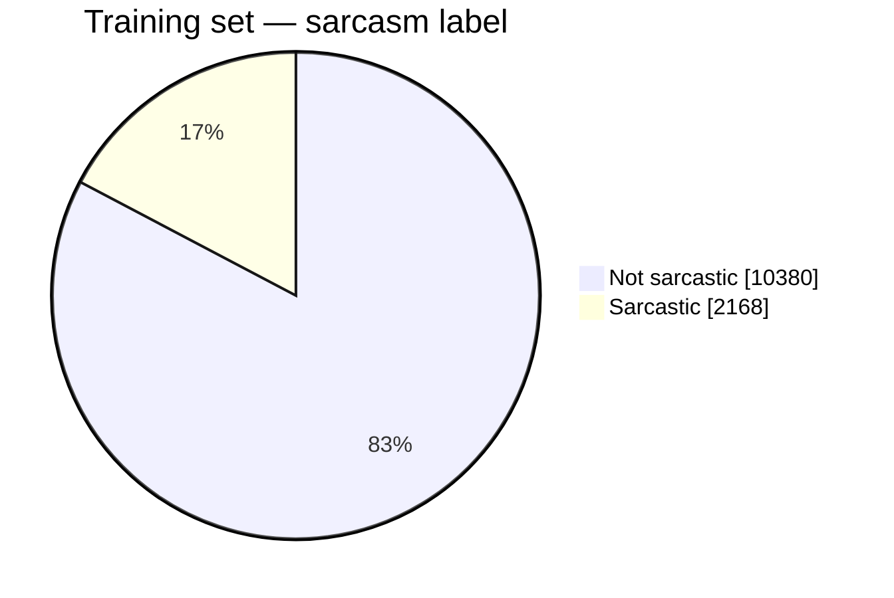
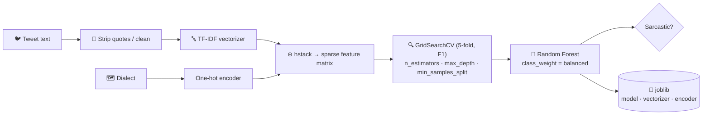
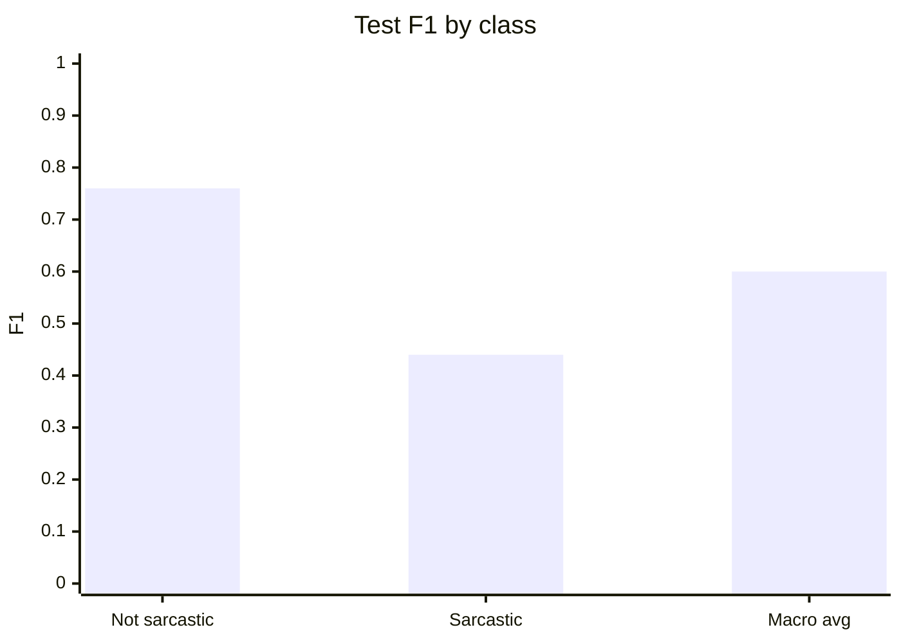

<div align="center">

# 🙃 Arabic Sarcasm Detection

**Detecting sarcasm in Arabic tweets across five dialect regions — TF-IDF + dialect features with a class-balanced, grid-searched Random Forest on ArSarcasm-v2.**

[](https://www.python.org/)
[](https://scikit-learn.org/)
[](https://www.kaggle.com/code/mohamedabi/notebook9f0151717d)
[](https://github.com/iabufarha/ArSarcasm-v2)
[](#-dataset)

**Web interface →** [Arabic_sarcasm_detection_interface](https://github.com/mohamedabi17/Arabic_sarcasm_detection_interface)

</div>

---

## 🎯 Problem

Sarcasm flips the literal sentiment of a sentence — a hard problem for NLP, and harder still in Arabic, where **Modern Standard Arabic and regional dialects** coexist on social media with very different vocabularies.

---

## 📚 Dataset

[ArSarcasm-v2](https://aclanthology.org/2021.wanlp-1.36/) (WANLP 2021 shared task): **15 548 tweets** annotated for sarcasm, sentiment and dialect.

| Split | Tweets | Sarcastic |
|---|:---:|:---:|
| Train | 12 548 | 2 168 (17 %) |
| Test | 3 000 | 821 (27 %) |



Dialects: `msa` · `egypt` · `levant` · `gulf` · `magreb`.

---

## 🏗️ Pipeline



**Design choices**
- **Dialect as a feature** — the same word can be neutral in one dialect and ironic in another.
- **`class_weight='balanced'`** — counters the 1 : 5 class imbalance.
- **F1 as the tuning metric** — accuracy alone would reward predicting "not sarcastic" everywhere.
- **joblib artefacts** — the fitted vectorizer, encoder and model are reused by the web interface.

---

## 📊 Results (official test set, 3 000 tweets)

| Class | Precision | Recall | F1 |
|---|:---:|:---:|:---:|
| Not sarcastic | 0.79 | 0.73 | 0.76 |
| **Sarcastic** | 0.41 | 0.49 | 0.44 |
| Macro avg | 0.60 | 0.61 | 0.60 |
| **Accuracy** | | | **0.66** |



A classical bag-of-words baseline: it captures lexical cues of sarcasm but not context. Next steps are Arabic transformer models (AraBERT, MARBERT) and joint sentiment–sarcasm training, which lead the WANLP 2021 leaderboard.

---

## 🚀 Quick start

Open the notebook on Kaggle (one click, data attached) or run locally:

```bash
pip install numpy pandas scikit-learn scipy joblib jupyter
jupyter notebook notebook9f0151717d.ipynb
```

Data path inside the notebook: `Dataset/ArSarcasm-v2-main/ArSarcasm-v2-main/ArSarcasm-v2/`.

---

## 📁 Repository

```
.
├── notebook9f0151717d.ipynb      # Sarcasm detection pipeline (Kaggle)
├── Dataset/ArSarcasm-v2-main/    # ArSarcasm-v2 (train / test CSV)
├── Sceintfic_Report_Model.pdf    # Scientific report
├── Mini Projet8.docx             # Project brief
└── audio_voice_detection.ipynb   # Side experiment: MFCC/chroma audio classifier (Keras)
```

---

## 🙏 Credits

ArSarcasm-v2 — Abu Farha, Zaghouani & Magdy, *Overview of the WANLP 2021 Shared Task on Sarcasm and Sentiment Detection in Arabic*.

---

<div align="center">

**Mohamed Abi** · [GitHub @mohamedabi17](https://github.com/mohamedabi17)

</div>
